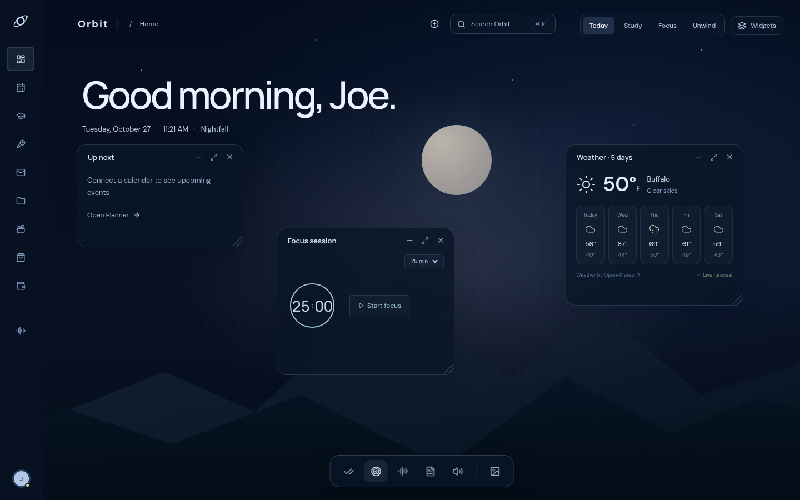
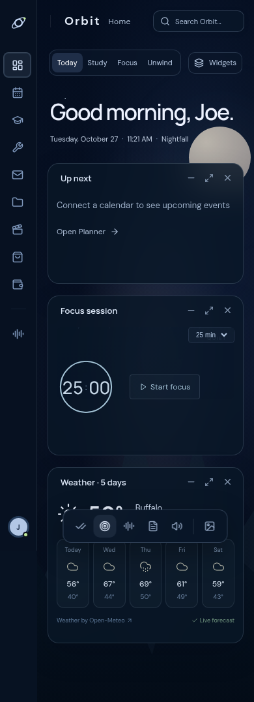

# Home rebuild — 4.5.1

The user rejected the dense 4.5 Home and supplied an earlier Orbit concept as the visual target, confirming a LifeAt-inspired scene-first workspace with fewer panels. This revision rebuilds Home’s composition around that reference.

- Full-screen Midnight Navy scene with an original CSS moon, stars and layered mountains; no proprietary LifeAt assets or additional image service.
- Slim 78px icon rail, small Orbit/Home breadcrumb, large local-time greeting and one date/time line. Removed the separate Home page header, outer card frame and footer.
- Today starts with Up next, Focus and five-day Weather. Study starts with Priorities, Focus and Notes; Focus opens Focus and Ambient; Unwind opens Spotify and Continue watching.
- One compact bottom dock opens, hides and restores all eleven tools and the background library. Direct drag, resize, minimize, close, maximize and richer expanded content remain functional.
- The earlier `orbit-immersive-home-v1` layout is preserved. Rebuilt layouts use `orbit-home-scene-v2`; the prior selected background carries forward. Both keys are supported by validated backups, with custom image bytes excluded.
- Mobile uses the same scene with stacked open panels and a horizontally scrollable dock. Classic Home and the separate full modules remain available.

The new scene acceptance test checks the three-panel default, single-screen desktop, slim navigation, dock operations, each context’s defaults, notes, old-layout preservation, backup inclusion and mobile overflow. Existing all-widget tests explicitly open all optional windows in an isolated test layout so expansion and lifecycle coverage remain complete. An older voice test now waits for React to render its mocked transcript before asserting.

Desktop: 

Mobile: 

Screenshots use disconnected-account states and public weather; no personal account records are fabricated. Provider configuration and local Mac installation remain separate from this code update.
