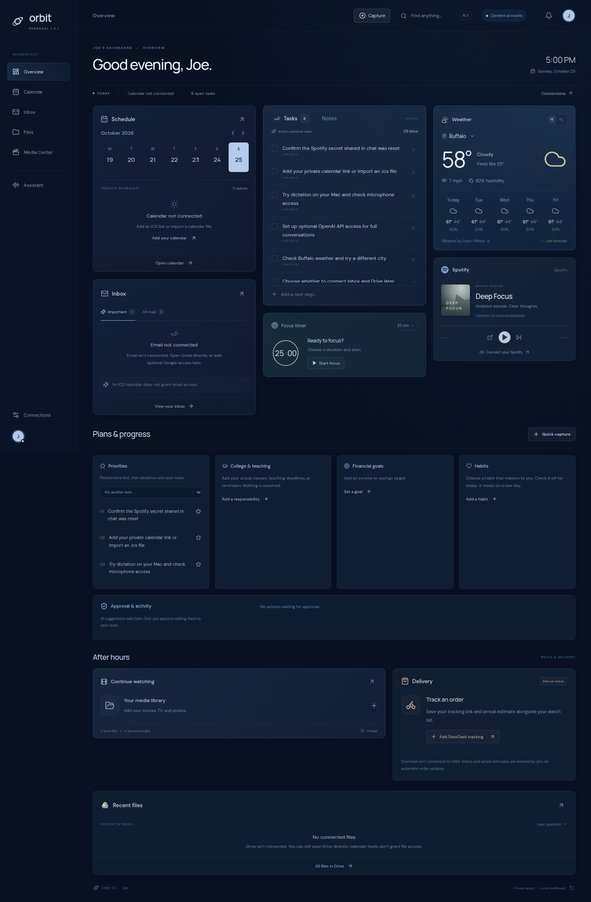

# Orbit 3.1 visual review

Scope: visual refinement only. V3 is preserved on `orbit-v3`; this work is isolated on `orbit-v3.1`. No new integrations, account changes or public deployment.

## Pass 1 — Hierarchy and personal identity

Removed the central copilot card and all rendered character graphics. Kept optional assistant controls in the sidebar. Put tasks beside the schedule, with weather/music and focus still accessible. Greeting addresses Joe and updates from the device's local time every 30 seconds, including while a page stays open across noon or evening. Removed the greeting subtitle, slogans and redundant large media labels. Existing browser data keys and account setup stay unchanged.

## Pass 2 — Navy space language and density

Reworked surfaces into layered navy, muted blue borders and restrained orbital branding. No illustrated planets, faces, cartoon figures or decorative hero. Added labeled desktop navigation and a compact icon rail at smaller widths. Rebalanced tasks, calendar, weather and Spotify; gave tasks a stronger visual hierarchy and shortened empty-state copy without inventing personal data. Academic responsibilities, money goals, habits, media, delivery and backups remain available.

## Pass 3 — Screenshot and interaction review

Reviewed desktop/mobile renders. Corrected inherited active-navigation CSS that positioned the text outside its button, and wrapped media sort controls at a 320px viewport. Checked local-time noon/evening changes with a simulated clock, every navigation view at 320/390/768/1024/1440 widths, saved notes and capture access. Updated existing browser checks to enter the optional assistant via sidebar and use the intended shorter headings. Corrected a test fixture that used the host UTC date while the browser used New York time; the application calendar implementation is unchanged.

Validation commands: npm run build; npm test; npm run test:e2e; npm run test:v3; npm run test:v31. Live private Spotify/Google accounts are not available in this workspace, so provider account flows use fixtures; existing provider code is unchanged. No new paid service is introduced.

Final results: production build passed; 52 service/storage/updater tests, 17 dashboard/integration regression checks, 19 media/V3 checks, and 7 visual/personal-greeting checks passed. Noon and evening transitions were tested without reloading. Functional account flows use mocks; private Spotify/Google accounts were not available here. The visual-only changes do not require reconnecting accounts when private configuration and the browser origin are retained.

